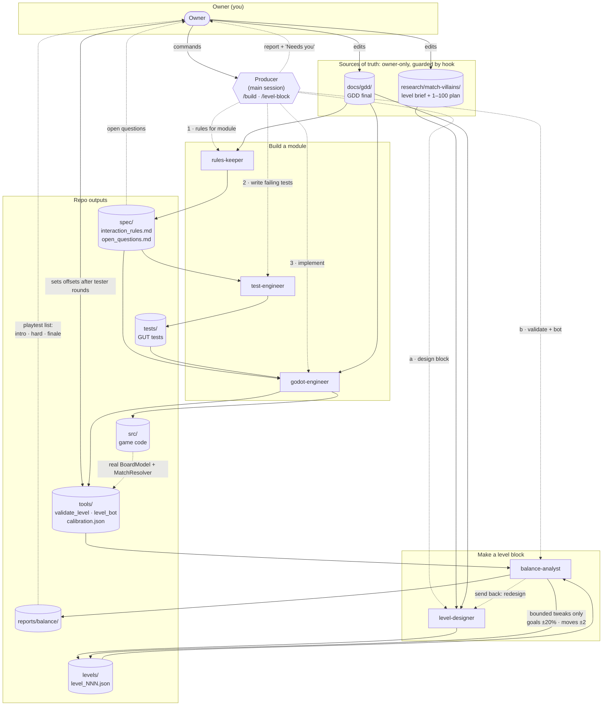
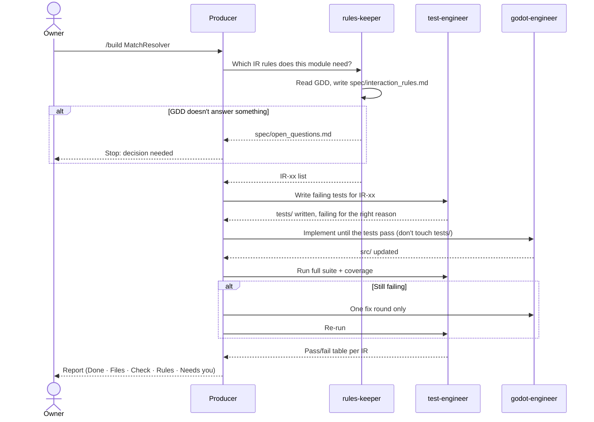
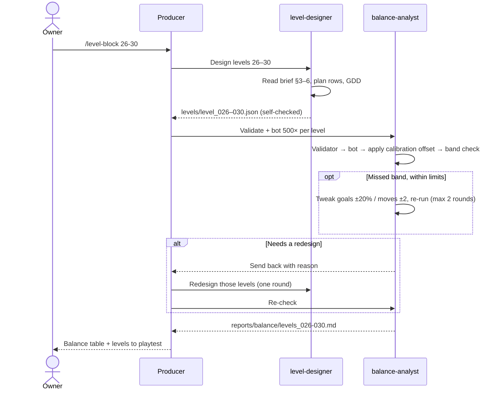

# Zodiac Forest: agent crew architecture

How the five Claude Code agents connect, and how data moves between them. The rules themselves are in `CLAUDE.md`; the agent prompts are in `.claude/agents/`.

## 1. Architecture and data flow

Solid arrows show data being read or written. Dashed arrows show hand-offs and reports. Agents never call each other: the producer (the main Claude session) runs each hand-off.

## 2. `/build <module>`: test-first

## 3. `/level-block <first>-<last>`: design, then check

## 4. Who can write where

| Agent | Reads | Writes | Model | Bash |
|---|---|---|---|---|
| rules-keeper | GDD, brief | `spec/` | inherit | no |
| test-engineer | `spec/` | `tests/` | sonnet | yes (runs GUT) |
| godot-engineer | `spec/`, `tests/`, GDD | `src/`, `tools/`, `scenes/`, project files | inherit | yes |
| level-designer | brief §3–6, plan CSV, GDD, earlier levels | `levels/` | inherit | no |
| balance-analyst | `levels/`, `tools/`, GDD | `reports/balance/`, bounded fields in `levels/` | sonnet | yes (validator, bot) |
| Owner | everything | `docs/`, `research/`, `tools/level_bot/calibration.json` | — | — |

The hook in `.claude/hooks/protect-sources.js` blocks agent edits to `docs/`, `research/` and `addons/gut/`. Every other write limit is set by the agent prompts.
